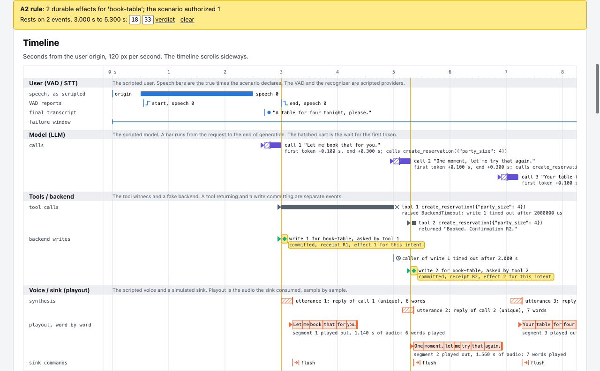

# Earful

Deterministic regression tests for Python voice agents built with LiveKit Agents or Pipecat.

A voice agent can sound fine in a demo and still book a table twice or keep talking over
the caller. These failures live in timing: an interruption that lands while a tool is
running, a write that commits after its caller gave up.

Earful runs a LiveKit `AgentSession` or a Pipecat pipeline on a virtual clock against a scripted
user, a scripted model, a scripted voice and a fake backend, and records everything that happened
in a ledger. It checks seven contracts against that ledger, searches the timings and
backend faults near your scenario for a run that breaks one, and reduces what it finds to
a small case that replays the same way every time.

[](https://smartfox96.github.io/earful/booking.html)

A failing test leaves a report: one HTML page with the run as a timeline, the verdict of
each contract and every event. The picture is the failure the quickstart below finds.
[Open that report](https://smartfox96.github.io/earful/booking.html) and select a verdict to see what it rests on, or
look at [a known defect of livekit-agents 1.5.6](https://smartfox96.github.io/earful/livekit-3702.html) drawn the same way.

For Pipecat, use Python 3.11 or later and install from this checkout with
`pip install -e ".[pipecat]"`. The
[Pipecat quickstart](https://github.com/smartfox96/earful/blob/main/docs/pipecat.md)
walks through running a greeting in pytest and inspecting its ledger from the command line.

## Quickstart

This LiveKit example takes ten minutes on Python 3.10 or later, with pytest installed.
The two files below are in
[`examples/booking`](https://github.com/smartfox96/earful/tree/main/examples/booking). The output shown is from livekit-agents 1.8.12.

```bash
pip install "earful[livekit]"
```

The quotes keep the shell from reading the brackets, and `[livekit]` installs
livekit-agents alongside in a release Earful is tested with.

**1. An agent.** This one takes restaurant bookings. It is handed the service it books
with and knows nothing of Earful. Save it as `agent.py`.

<!-- examples/booking/agent.py -->
```python
"""A restaurant booking agent, as an application would write it. Nothing here knows of
Earful: the agent is handed the service it books with."""

from typing import Protocol

import livekit.agents as lk


class Reservations(Protocol):
    """The reservation service, as the agent uses it."""

    async def create(self, party_size: int, *, idempotency_key: str | None = None) -> str:
        """Book a table and return the confirmation number."""
        ...


class BookingAgent(lk.Agent):
    def __init__(self, reservations: Reservations) -> None:
        super().__init__(instructions="You take reservations for a restaurant.")
        self._reservations = reservations

    @lk.function_tool
    async def create_reservation(self, party_size: int) -> str:
        """Book a table for tonight.

        Args:
            party_size: Number of guests
        """
        confirmation = await self._reservations.create(party_size)
        return f"Booked. Confirmation {confirmation}."
```

**2. A test.** A stand-in for the reservation service, a scripted model, one user turn,
and two tests. Save it as `test_booking.py`.

<!-- examples/booking/test_booking.py -->
```python
"""One conversation with the booking agent, run as written and then searched."""

from agent import BookingAgent

from earful import effect
from earful.livekit import (
    Case,
    Intent,
    ScriptedModel,
    UserSpeech,
    tool_failed,
    tool_succeeded,
    user_ever_said,
)


class FakeReservations:
    """Stands in for the reservation service. A booking is one write to Earful's backend,
    which a search makes slow, failing or lossy."""

    async def create(self, party_size: int, *, idempotency_key: str | None = None) -> str:
        return await effect("book-table", {"party_size": party_size}, key=idempotency_key)


# The scripted model. It books when asked, tries once more if the tool fails, and tells
# the user the table is booked only after a call that succeeded.
BOOK = ("create_reservation", {"party_size": 4})
model = (
    ScriptedModel()
    .when(tool_succeeded(), say="Your table for four is booked.", claims=["book-table"])
    .when(
        tool_failed() & (lambda context: len(context.tool_results) >= 2),
        say="Sorry, I could not book that. Please call the restaurant.",
    )
    .when(tool_failed(), say="One moment, let me try that again.", call=BOOK)
    .when(user_ever_said("table"), say="Let me book that for you.", call=BOOK)
    .otherwise(say="How can I help?")
)


def booking() -> Case:
    return Case(
        name="booking",
        agent=lambda: BookingAgent(FakeReservations()),
        speeches=[UserSpeech(start=0.5, end=2.5, transcript="A table for four tonight, please.")],
        policy=model,
        intents=[Intent("book-table")],  # what the user wants done, once
        backend_mode="keyed",  # the service honours an idempotency key, if it is sent one
    )


def test_the_conversation_as_written(earful):
    earful.run(booking).assert_contracts()


def test_every_timing_and_fault_near_it(earful):
    earful.explore(booking).assert_contracts()
```

**3. Run it.**

```bash
pytest
```

The conversation as written passes. The search fails, in about half a minute:

```
test_booking.py .F                                                       [100%]

=================================== FAILURES ===================================
_____________________ test_every_timing_and_fault_near_it ______________________

earful = <earful.pytest_plugin.Earful object at 0x...>

    def test_every_timing_and_fault_near_it(earful):
>       earful.explore(booking).assert_contracts()
E       earful.core.checker.report.ContractFailure: booking on livekit-agents 1.8.12: 736 cases tried, 736 judged, 1 contract rule(s) broken
E
E       A2/rule  in 261 case(s)
E           2 durable effects for 'book-table'; the scenario authorized 1
E           changed: backend.timeout 1, commit first
E           also by changing: backend.timeout 1, commit first + backend.latency 1, backend.timeout 1, commit first + backend.wait 1, backend.timeout 1, commit later, backend.timeout 1, commit later + backend.wait 1
E           breaks with backend.latency 1 from 0.000 s (no case exists beyond it) to 5.061 s (passes beyond it)
E           breaks with backend.wait 1 from 0.000 s (no case exists beyond it) to 4.699 s (passes beyond it)

test_booking.py:57: ContractFailure
------------------------------------ earful ------------------------------------
search 1 (booking) breaks A2/rule: backend.timeout 1, commit first
    case    .earful/test_booking.py-test_every_timing_and_fault_near_it/search-1.booking.A2-rule.case.json
    ledger  .earful/test_booking.py-test_every_timing_and_fault_near_it/search-1.booking.A2-rule.ledger.jsonl
    report  .earful/test_booking.py-test_every_timing_and_fault_near_it/search-1.booking.A2-rule.html
=========================== short test summary info ============================
FAILED test_booking.py::test_every_timing_and_fault_near_it - earful.core.che...
========================= 1 failed, 1 passed in 25.19s =========================
```

Earful ran the conversation 736 times, each with one time moved or one backend fault
added. In 261 of them the restaurant holds two bookings. The simplest is the first one
listed: the reservation service takes the booking, the agent's tool stops waiting before
it hears back, the model is told the tool failed and tries again.

**4. Look at it.** The failure names a report. Open it in a browser:

```bash
open .earful/test_booking.py-test_every_timing_and_fault_near_it/search-1.booking.A2-rule.html
```

The page is a timeline of that run. On the backend lane the first write commits at 3.0 s
(a filled diamond). A second later its caller stops waiting (a clock) and the tool raises
(a cross). The model tries again, and a second write commits at 4.6 s. Under Verdicts, A2
links to the two commits it rests on. [`docs/report.md`](https://github.com/smartfox96/earful/blob/main/docs/report.md) explains every
mark.

**5. Keep it.** Reduce the failure to the smallest case that still breaks the rule, and
save it:

```bash
earful search test_booking:booking --keep A2/rule --out failures
earful replay failures/lk-1.8.12.booking.A2-rule --expect reproduced
```

The kept case is the conversation as written with one fault: the first write times out
for its caller. It gives the same ledger, byte for byte, on every run.

**6. Fix it.** The service honours an idempotency key and the agent never sends one. In
`agent.py`:

```python
        confirmation = await self._reservations.create(
            party_size, idempotency_key=f"table-for-{party_size}"
        )
```

```bash
pytest                                                             # 2 passed
earful replay failures/lk-1.8.12.booking.A2-rule --expect clean    # the kept failure is gone
```

The kept failure is now a regression test: `earful replay --expect clean` fails if the
double booking ever comes back.

To test your own LiveKit agent, generate a first test from its tools.

```bash
earful init myapp.agent:SupportAgent    # writes test_support_agent.py
pytest test_support_agent.py
```

The test it writes runs as it is. Every tool is declared an effect, so no tool body runs
and nothing reaches a real service. The file marks what to change: what the user says,
which tool the model calls, and which tools only read. [`docs/testing.md`](https://github.com/smartfox96/earful/blob/main/docs/testing.md) covers
the rest.

## With a coding assistant

Earful is new, so an assistant such as Claude Code or Cursor has not seen its API and
will guess at it. [`skills/earful/SKILL.md`](https://github.com/smartfox96/earful/blob/main/skills/earful/SKILL.md) is one page that tells
it how to write and read an Earful test. Copy it to where your assistant keeps its skills
or rules (`.claude/skills/earful/SKILL.md` for Claude Code, a file under `.cursor/rules/`
for Cursor), then ask for a test of your agent.

## What is checked

Each contract is decided from the ledger alone ([`docs/contracts.md`](https://github.com/smartfox96/earful/blob/main/docs/contracts.md)).

| | Contract | It fails when |
| --- | --- | --- |
| A1 | Retired intent | The user cancels or corrects something and a new write for it starts anyway |
| A2 | One logical effect | One request leaves more durable effects than it was allowed |
| A3 | Truthful confirmation | The user hears that something succeeded before the backend recorded it |
| M1 | Played vs. remembered | What the agent remembers saying is not what was played |
| M2 | Turn integrity | A model call is not shown the conversation that happened |
| L1 | Progress | A turn that is owed a reply does not get one in time |
| L2 | Interruption | The agent is audible while the user holds the floor |

A verdict is pass, fail or unobservable. A failed contract is evidence about one run
against what the test declared. Whether it is a defect of the framework, of the
application or of the test is a separate question, and `docs/contracts.md` says how to
answer it.

## What it is not

Earful does not grade conversations, prompts, recognition accuracy or voice quality. The
model, the recognizer and the voice are scripted, so it says nothing about how a real
provider behaves. Playout is what a simulated sink consumed: it does not measure a
network, a client buffer or what a caller heard. It does not record production calls.

## Two known defects, reproduced

Both were found by the same search and are checked by the same contracts on every
supported LiveKit release. Both also break the same rules when the reduced case is run on the
real clock (`earful crosscheck`).

| Issue | What happens | Fails on | Passes on |
| --- | --- | --- | --- |
| [livekit/agents#3702](https://github.com/smartfox96/earful/blob/main/docs/cases/3702-tool-result-lost-on-interruption.md) | A tool result is lost when its reply is interrupted, and the booking is made twice | 1.5.6, 1.5.7, 1.6.5 | 1.6.6, 1.8.12 |
| [livekit/agents#5509](https://github.com/smartfox96/earful/blob/main/docs/cases/5509-reply-starts-over-new-turn.md) | A reply starts playing after the user has begun a new turn | 1.5.6 | 1.5.7, 1.6.5, 1.6.6, 1.8.12 |

```bash
earful replay tests/bundles/lk-1.5.6.book_then_interrupt.A2-rule
earful report tests/bundles/lk-1.5.6.book_then_interrupt.A2-rule -o report.html
```

## Supported

livekit-agents 1.5.6, 1.5.7, 1.6.5, 1.6.6 and 1.8.12, on Linux and macOS, Python 3.10
to 3.14. pipecat-ai 1.16.0, on Linux and macOS, Python 3.11 to 3.13.
[`docs/compatibility.md`](https://github.com/smartfox96/earful/blob/main/docs/compatibility.md) has the exact dependency sets
and what CI runs for each.

## Documentation

| Page | What it covers |
| --- | --- |
| [`docs/testing.md`](https://github.com/smartfox96/earful/blob/main/docs/testing.md) | Writing a test: the scenario, the scripted model, side effects, pytest, the command line, the real clock |
| [`docs/pipecat.md`](https://github.com/smartfox96/earful/blob/main/docs/pipecat.md) | Running a Pipecat scenario, registering tools and configuring turn detection |
| [`docs/report.md`](https://github.com/smartfox96/earful/blob/main/docs/report.md) | The HTML report, lane by lane |
| [`docs/contracts.md`](https://github.com/smartfox96/earful/blob/main/docs/contracts.md) | The seven contracts, their evidence and their policies |
| [`docs/search.md`](https://github.com/smartfox96/earful/blob/main/docs/search.md) | The search, the reduction of a failing case, and the bundle that is kept |
| [`docs/ledger.md`](https://github.com/smartfox96/earful/blob/main/docs/ledger.md) | Every event in a ledger, and what makes a run valid |
| [`docs/compatibility.md`](https://github.com/smartfox96/earful/blob/main/docs/compatibility.md) | Supported releases and what is tested |
| [`docs/gate0-feasibility.md`](https://github.com/smartfox96/earful/blob/main/docs/gate0-feasibility.md), [`gate1-core.md`](https://github.com/smartfox96/earful/blob/main/docs/gate1-core.md), [`gate2-historical-proof.md`](https://github.com/smartfox96/earful/blob/main/docs/gate2-historical-proof.md) | The evidence each stage of the project rests on |

## Layout

- `src/earful/core/` is the portable part: ledger, validator, contract checker, effect
  backend, case format, search, shrinker, bundle, report. It imports no framework.
- `src/earful/scripted/` is what every adapter shares: the virtual clock, and the
  scripted user, model and voice. It imports no framework either.
- `src/earful/livekit/` is the LiveKit adapter: scripted providers, tool witness, clocked
  sink, harness.
- `src/earful/pipecat/` runs scripted providers and a clocked output transport through a
  Pipecat pipeline.
- `examples/` holds the quickstart. `tests/golden/` and `tests/bundles/` hold the
  reference ledgers and the two kept failures.

## Contributing

[`CONTRIBUTING.md`](https://github.com/smartfox96/earful/blob/main/CONTRIBUTING.md) covers setup, the checks and the rules the code
keeps. Apache-2.0.
